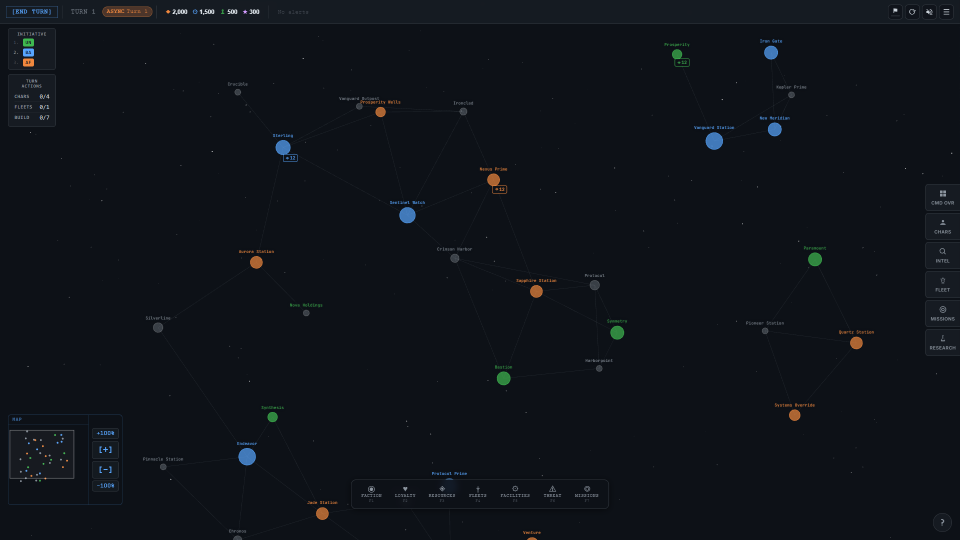

# Branded Galaxy

A compact sci-fi grand-strategy game for small groups of friends. It's built with React, TypeScript, Phaser 3 and Supabase, and inspired by classic space grand-strategy games.

**[▶ Play the live build](https://pyremonk.github.io/branded-galaxy/)**: offline mode needs no account.



## About

You command one of three asymmetric factions in a procedurally generated galaxy. You manage resources, research technology, build fleets and facilities, and send characters on covert missions to win systems over. The game is designed so friends can play **asynchronously**, taking turns throughout the day, and switch to **real-time** play when everyone is online at once.

## Features

- **Procedural galaxy**: seeded generation of sectors, star systems and hyperspace lanes in small, medium or large maps, with chokepoints, trade hubs and research worlds.
- **Three asymmetric factions**: Brand Authority (economic leverage and loyalty), Union (covert ops and diplomacy) and Autoforge (rapid synthetic expansion), each with its own tech tree and victory conditions.
- **Fleets and combat**: fleet composition, lane and direct-travel movement, space combat, planetary defenses and ground invasions.
- **Characters and missions**: a leader roster, mission assignment, success calculation, and capture and rescue.
- **Economy and construction**: four resources, base types, facility build queues and income driven by planet loyalty.
- **Diplomacy and loyalty**: a planet loyalty system, diplomatic actions and system capture.
- **Intelligence and fog of war**: intel gathering, reports and counter-intelligence.
- **AI opponents**: computer-controlled factions with strategy and action planning.
- **Multiplayer**: hot-seat, online lobbies, and a hybrid async/sync mode with host election, deterministic simulation and snapshot reconciliation.
- **Quality of life**: an alert system, a tutorial campaign, in-game help, save/load and a mini-map.

## Tech stack

| Layer | Technology |
|---|---|
| UI | React 19 and TypeScript |
| Game engine | Phaser 3 |
| Build | Vite 5 |
| Backend | Supabase (auth, Postgres, Realtime), optional |
| Hosting | GitHub Pages (live build) |

## Architecture

```
React UI layer      landing page, auth, menus, HUD panels, modals
      ↕  window CustomEvents
Phaser engine       galaxy rendering, camera, map interaction (engine/)
      ↕
Core systems        pure game logic: turns, combat, missions, AI, ... (core/)
      ↕
Data bridge         Supabase in cloud mode, localStorage in offline mode
```

React renders first and handles authentication, then starts Phaser. Game rules live in `core/` as engines (stateless rules) and state managers (persistence). Gameplay is seeded and deterministic, so clients in a multiplayer session can simulate the same turn and get the same result.

```
src/          React app: App.tsx, components/, contexts/, hooks/, types/
engine/       Phaser scenes (boot-stage, main-stage)
core/         Game systems, state managers and JSON game data
ui/           Phaser entity classes (systems, sectors)
assets/       Static assets served at the site root (publicDir)
supabase/     schema.sql and incremental migrations
.prodspec/    Product catalog, roadmap and per-feature specs
docs/         Player-facing guides
```

## Running locally

```bash
npm install
npm run dev
```

Open <http://localhost:3030/branded-galaxy/>. With no Supabase credentials the game runs in **offline mode** and saves to localStorage. Click **Play Offline** on the landing page.

| Script | Purpose |
|---|---|
| `npm run dev` | Dev server on port 3030 |
| `npm run build` | Production build to `dist/` |
| `npm run preview` | Preview the production build |

## Configuration

Copy `.env.example` to `.env.local` and fill in what you need. Every variable is optional.

| Variable | Default | Description |
|---|---|---|
| `VITE_SUPABASE_URL` | none | Supabase project URL. Cloud mode is enabled when this and the key are both set. |
| `VITE_SUPABASE_ANON_KEY` | none | Supabase anon (public) key. |
| `VITE_FEATURE_EVENT_SYSTEM` | `false` | Enables random galactic events. |
| `VITE_FEATURE_SIGNUPS` | `false` | Shows account creation. When off, the landing page shows a request-access contact form instead. |

Feature flags are read at build time in [core/feature-flags.js](core/feature-flags.js) and accept `true`/`1`/`yes`/`on`.

> **Note:** `VITE_FEATURE_SIGNUPS` only changes the UI. To actually block new accounts, also turn off **Allow new users to sign up** in the Supabase dashboard (Authentication → Sign In / Providers).

### Backend setup (optional)

1. Create a Supabase project.
2. Run [supabase/schema.sql](supabase/schema.sql) in the SQL editor. It creates every table, the row-level security policies and the Realtime publications.
3. Put the project URL and anon key in `.env.local`.

### Licensed assets

The character portraits come from a commercial asset pack that can't be redistributed, so they aren't included here. The game shows a generic silhouette wherever a portrait would appear. See [assets/transparent-character-portraits/README.md](assets/transparent-character-portraits/README.md) if you own the pack.

## About this repository

This is a public, code-only mirror of the project. The [live build](https://pyremonk.github.io/branded-galaxy/) is deployed from a private repository that also holds the licensed art. To host your own copy, the build output in `dist/` is a static site. Set `base` in [vite.config.ts](vite.config.ts) to match the path you serve it from.

## Development process

The project is built spec-first. Every feature has a numbered spec under [.prodspec/specs/](.prodspec/specs/). The [feature catalog](.prodspec/product/feature-catalog.md) records what has shipped and the [roadmap](.prodspec/product/roadmap.md) tracks what's next. Architecture notes and known pitfalls for AI-assisted development are in [.github/copilot-instructions.md](.github/copilot-instructions.md).

For a player's guide to the opening turns, see [docs/FACTION_WALKTHROUGH.md](docs/FACTION_WALKTHROUGH.md).

## Credits

- Character portraits: [*Scifi Characters Icons*](https://www.gamedevmarket.net/asset/scifi-characters-icons-8706) by Rexard, used under the [GameDev Market Pro Licence](https://www.gamedevmarket.net/terms-conditions#pro-licence).
- Fonts: [Orbitron](https://fonts.google.com/specimen/Orbitron), [Inter](https://fonts.google.com/specimen/Inter) and [JetBrains Mono](https://fonts.google.com/specimen/JetBrains+Mono) via Google Fonts.

## License

The source code is licensed under the [MIT License](LICENSE). Third-party assets are **not** covered, aren't included in this repository, and remain under their original licenses.
